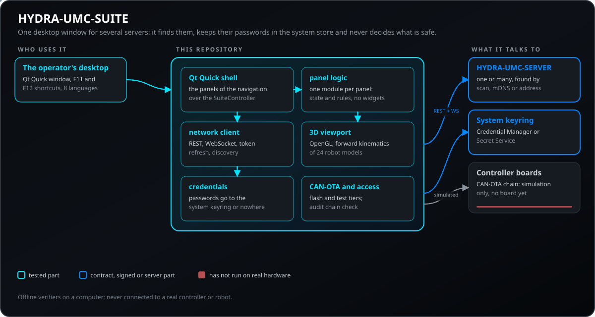
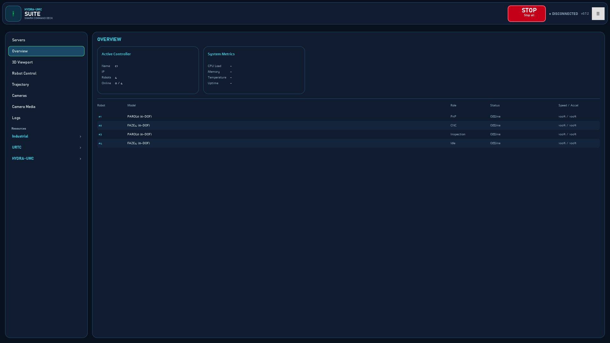
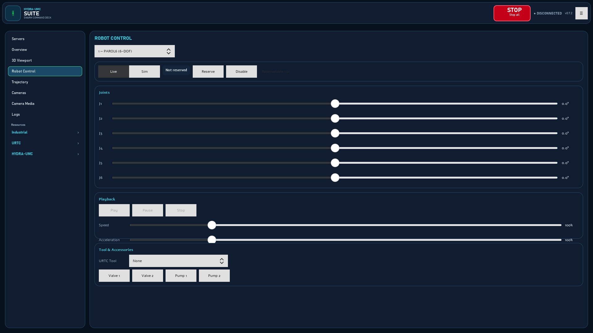
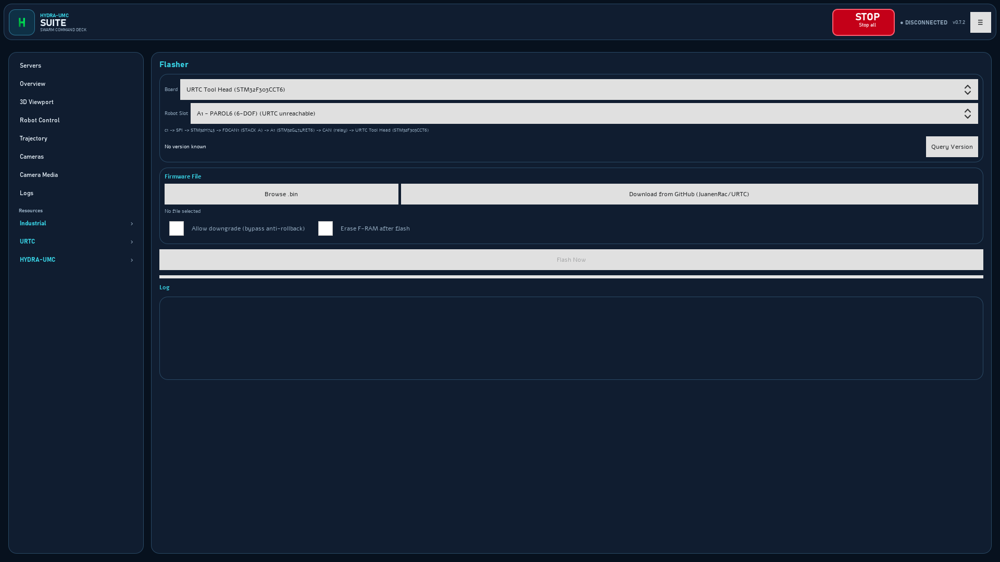
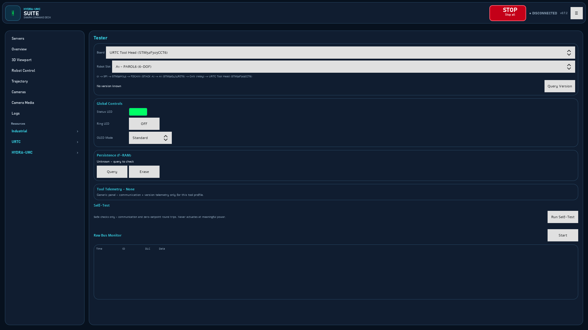
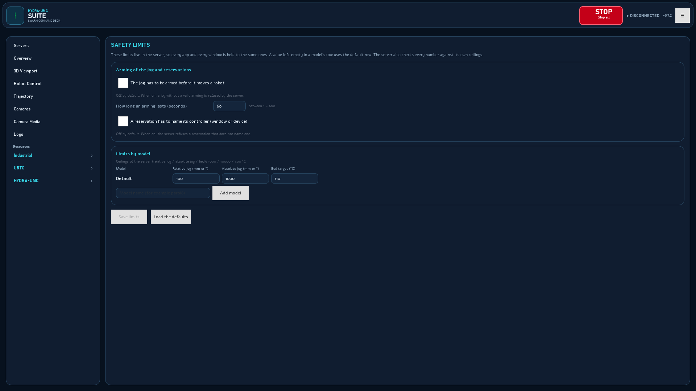
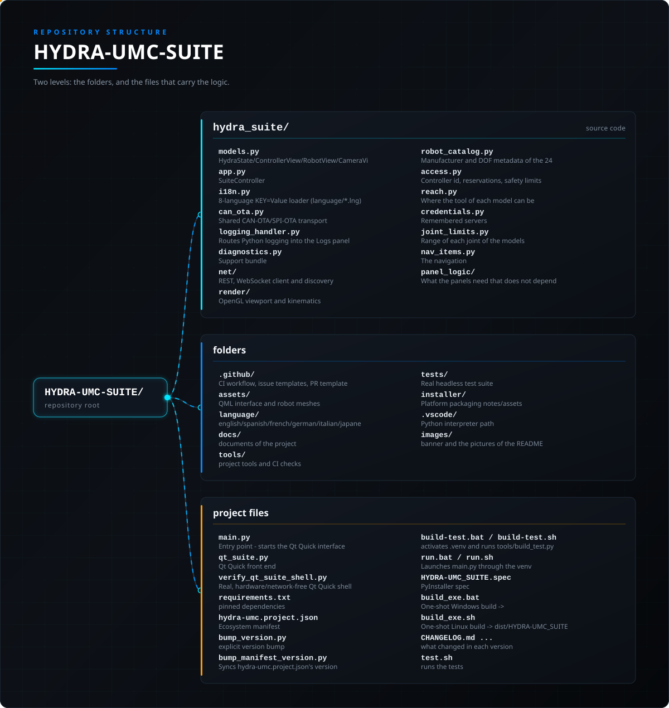

<!-- =============================================================================
HYDRA-UMC-SUITE - Desktop command center for several HYDRA-UMC servers at once
Copyright (C) JuanenRac (Electro Hobby 3D) <electrohobby3d@gmail.com>
GPL-3.0-or-later - see LICENSE
============================================================================= -->

<p align="center">
  
</p>

# 🖥️ HYDRA-UMC-SUITE

<p align="center"><a href="README.md">🇺🇸 English</a> | <a href="README_spa.md">🇪🇸 Español</a> | 🇫🇷 <b>Français</b> | <a href="README_ita.md">🇮🇹 Italiano</a> | <a href="README_deu.md">🇩🇪 Deutsch</a> | <a href="README_zho.md">🇨🇳 简体中文</a> | <a href="README_jpn.md">🇯🇵 日本語</a> | <a href="README_por.md">🇵🇹 Português</a></p>

### 🖥️ Centre de Commande d'Essaim Multi-Contrôleur pour la Plateforme HYDRA-UMC

<p align="center">
  
  
  
  
  
  
  
</p>

---

**Vérification d'honnêteté - ce qui fonctionne réellement aujourd'hui :** la découverte réseau (scan de sous-réseau concurrent + véritable mDNS/Bonjour, `hydra_suite/net/discovery.py`), la connexion REST+WebSocket en direct et le support d'essaim (`hydra_suite/net/client.py`, `hydra_suite/app.py`), la cinématique directe réelle de la vue 3D pour les 24 vrais modèles de robots plus un repli « Generic » (`hydra_suite/render/`), les 11 panneaux de configuration d'outils sur 11, le flashage CAN-OTA/SPI-OTA, et le rendu vidéo MJPEG réel des caméras sont réels et testés - 47 scripts de vérification/smoke sous `tests/` (`python tools/run_offline_verifiers.py`, Qt sans tête via `QT_QPA_PLATFORM=offscreen`), tous en succès. L'interface est uniquement Qt Quick (`qt_suite.py`) : les 34 panneaux de la navigation sont du code réel et fonctionnel, y compris la vue 3D via un `OffscreenRobotRenderer` dédié ; la fenêtre classique a été retirée. Ce qui n'est explicitement PAS encore fait, selon la propre convention d'honnêteté de ce dépôt : les niveaux URTC Tool Head/Advanced Expansion du CAN-OTA n'ont pas encore de véritable tunnel de relais matériel ; et `combinedWith` (mode robot combiné) n'est pas exposé dans l'UI de cette application bien qu'il existe dans le propre modèle de données de STUDIO. Le panneau Trajectoire exporte/importe désormais via le véritable format `WORKS/*.json` de HYDRA-UMC STUDIO (`POST /api/upload-work`, `GET /<dossier>/index.json`) - un point enregistré ici est un Work réel et lisible depuis les deux applications. Voir [`docs/ROADMAP.md`](docs/ROADMAP.md) pour le détail complet, poste par poste, du réel par rapport au différé que ce paragraphe résume, et `CHANGELOG.md` pour ce qui a déjà été livré exactement.

---

> **État de la sûreté et de la cybersécurité :** cet écosystème n'est pas un système de sécurité certifié. Il n'existe pas encore de chaîne d'E-STOP matérielle, ni de limites ou de verrouillages imposés par le firmware, ni de commande de mouvement vérifiée ; les images de firmware sont contrôlées par CRC-32 et une signature Ed25519, et une compilation de version refuse les clés de développement publiées (les têtes d'outil et les cartes d'extension derrière le relais utilisent encore les chargeurs d'URTC, qui prennent un HMAC-SHA256 à clé partagée au lieu d'une signature) ; TLS et TLS mutuel sont optionnels et désactivés par défaut ; aucune carte propre n'a encore été assemblée ni testée. Lisez la [base de sécurité](https://github.com/JuanenRac/HYDRA-UMC-DOCS/blob/main/docs/SECURITY_BASELINE.md) et le [modèle de menaces](https://github.com/JuanenRac/HYDRA-UMC-DOCS/blob/main/docs/THREAT_MODEL.md) avant de vous fier à une affirmation d'ici pour la sécurité d'une personne.

---

## 📋 En un coup d'œil

| | |
|---|---|
| Version | `0.7.6` |
| Maturité | Fonctionnel |
| Tests | 47 (`python tools/run_offline_verifiers.py`) |
| Technologie | Python 3.12 / PySide6 |
| Cible | Le PC de la personne qui l'utilise |
| Sur matériel réel | Pas encore : aucune exécution sur du matériel réel n'est consignée pour cette version |

**Aller à :** [Présentation](#-présentation) · [Architecture](#-architecture) · [Fonctionnalités](#-fonctionnalités) · [Sécurité et protection](#-sécurité-et-protection) · [Interfaces](#-interfaces) · [Configuration](#-configuration) · [Démarrage rapide](#-démarrage-rapide) · [Tests](#-tests) · [Dépannage](#-dépannage) · [Structure du dépôt](#-structure-du-dépôt) · [Projets liés](#-projets-liés)

## 🚦 État du projet

Chaque ligne est une partie de ce dépôt et le feu dit où elle en est aujourd'hui. Elle est écrite d'après ce que le dépôt peut montrer (tests, compilations, exécutions), pas d'après ce qui est prévu.

🟢 Fait et vérifié · 🟡 Fonctionne, avec des limites connues · 🟠 À moitié fait ou pas encore vérifié · 🔴 Pas fait ou ne fonctionne pas

| Domaine | État | Ce que cela veut dire ici |
|---|---|---|
| Logiciel | 🟡 | Fonctionne pour son usage principal ; la vérification d'honnêteté ci-dessus liste ce qui manque encore |
| Tests | 🟢 | 47 tests automatiques, exécutés à chaque modification |
| Matériel réel | 🔴 | Pas encore : aucune exécution sur du matériel réel n'est consignée pour cette version |
| Documentation | 🟢 | README en huit langues, vérifié par rapport au manifeste à chaque modification |

## 🎯 Présentation

**HYDRA-UMC SUITE** est une application de bureau native Windows/Linux
(Python + PySide6/Qt6) construite comme centre de contrôle de mission pour
toute une flotte de contrôleurs
[HYDRA-UMC](https://github.com/JuanenRac/HYDRA-UMC) à la fois - scanne le
réseau local (ou ajoutez-en un manuellement, y compris via un tunnel VPN
déjà connecté vers un HYDRA-UMC sur un réseau physique différent),
connectez-vous à autant que trouvés, et pilotez/surveillez/reconfigurez
n'importe lequel d'entre eux en direct, côte à côte, depuis un unique
tableau de bord industriel plein écran.

Il parle exactement le même protocole de communication qu'expose
[HYDRA-UMC SERVER](https://github.com/JuanenRac/HYDRA-UMC-SERVER) - le
même backend headless auquel parle aussi la propre interface navigateur de
[HYDRA-UMC STUDIO](https://github.com/JuanenRac/HYDRA-UMC-STUDIO), comme un
client parmi d'autres - voir
[`HYDRA-UMC-SERVER/docs/REMOTE_API.md`](https://github.com/JuanenRac/HYDRA-UMC-SERVER/blob/main/docs/REMOTE_API.md)
pour le contrat complet, ajouté spécifiquement pour prendre en charge ce
projet. Un changement effectué depuis SUITE apparaît en direct dans un
onglet de navigateur ouvert, et vice versa - synchronisation bidirectionnelle
réelle via WebSocket, pas un import/export ponctuel.

**Note d'honnêteté, suivant la même convention de documentation que le
reste de cet écosystème :** ceci est un premier passage réel et
fonctionnel, pas un produit fini. Voir
[`docs/ROADMAP.md`](docs/ROADMAP.md) pour savoir exactement ce qui est
véritablement implémenté et vérifié de bout en bout aujourd'hui, par
rapport à ce qui a été délibérément laissé hors périmètre pour plus tard.
À ce stade, chaque modèle de robot réel pris en charge par cet écosystème
dispose d'une géométrie STL réelle et d'une cinématique directe vérifiée
numériquement câblée dans le viewport 3D (Parol6, Faze4, AR3, AR4,
UR3e/5e/10e/16e/20, xArm6, Lite 6, e.DO), plus un mode de secours
"Générique" construit avec des primitives pour tout modèle sans jeu de
mailles dédié.

## 🧩 Rôle dans HYDRA-UMC

**HYDRA-UMC-SUITE** est le centre de commande de bureau de la cellule pour Windows et Linux : il trouve chaque HYDRA-UMC-SERVER du réseau (balayage de sous-réseau et mDNS, ou une adresse saisie), se connecte à autant que vous voulez et affiche, déplace et configure leurs robots côte à côte dans une interface Qt Quick avec vue 3D. C'est l'équivalent bureau de STUDIO, il parle le même protocole et ne décide rien en matière de sécurité : cela reste sur chaque serveur.

## 🏛️ Architecture

<p align="center">
  
</p>

## 🖼️ Captures d'écran

Capturées en 1920×1080 sur un banc d'essai, avec des données d'exemple et sans installation réelle derrière.

<table>
<tr><td width="50%" valign="top"><br><sub>Vue d'ensemble : le contrôleur actif, ses métriques système et la liste des robots avec modèle, rôle, état et vitesse.</sub></td><td width="50%" valign="top"><br><sub>Contrôle du robot : mode réel ou simulé, les boutons de réservation, les six curseurs d'articulation, la lecture et les accessoires de l'outil.</sub></td></tr>
<tr><td width="50%" valign="top"><br><sub>Flasher Studio : choisissez la carte et l'emplacement du robot, voyez le chemin de la mise à jour, un fichier de firmware, et flashez-le par CAN.</sub></td><td width="50%" valign="top"><br><sub>Tester Center : la LED d'état, la LED en anneau, le mode OLED, le contrôle de persistance, l'autotest et le moniteur de bus brut d'une carte.</sub></td></tr>
<tr><td width="50%" valign="top"><br><sub>Limites de sécurité : armement du jog, règle de réservation et plafonds de jog et de température du plateau par modèle de robot.</sub></td></tr>
</table>

## ✨ Fonctionnalités

### Console visuelle de commande

La fenêtre a un en-tête persistant, inspiré d'une console de jeu, avec l'icône officielle HYDRA-UMC et la palette bleu nuit/cyan de HYDRA-UMC-UPDATER. Il affiche le nom du produit, l'état de connexion et la version, et porte le bouton STOP global et le menu de l'application (langue, paquet de support, raccourcis clavier, À propos). La navigation vers les panneaux est la barre latérale gauche. Ce n'est pas un tableau de bord simulé : chaque panneau travaille sur les vrais serveurs.

### 🛑 STOP global

Le bouton **STOP** est toujours en haut de la fenêtre, sur tous les panneaux. Un clic, sans confirmation : il appelle `POST /api/stop-all` sur chaque serveur connecté et arrête tous les robots, même réservés par un autre compte. Il affiche le résultat : un message vert quand tout est arrêté, et un message rouge, qui reste jusqu'au prochain STOP, lorsqu'un robot ne s'est pas arrêté, que l'état d'arrêt n'a pas pu être enregistré ou que rien n'a confirmé l'arrêt (**STOP NON CONFIRMÉ**). Si le serveur limite l'appel, les robots sont arrêtés un par un. **F12** fait la même chose au clavier (listé dans **≡ > Raccourcis clavier**) ; c'est une touche de fonction seule, elle n'appuie donc jamais sur un bouton ayant le focus et ne ferme rien.

### L'interface Qt Quick

HYDRA-UMC SUITE a une seule interface, écrite en Qt Quick (QML) : une `ApplicationWindow` autonome (`assets/qml/Main.qml`) que `qt_suite.py` relie au `SuiteController` inchangé. C'est le même schéma qu'utilisent HYDRA-UMC-OS-REBUILDER, HYDRA-UMC-UPDATER, URTC-TESTER, URTC-FLASHER et HYDRA-UMC-EDITOR-URDF, et la même forme que HYDRA-UMC-STUDIO : une barre latérale de navigation (un menu racine plus les sous-menus Industrial, URTC et HYDRA-UMC, dans `hydra_suite/nav_items.py`) et une seule zone de contenu qui montre un des 34 panneaux à la fois. La vue 3D et les aperçus sont dessinés par un `OffscreenRobotRenderer` dédié (un `QOpenGLContext`, un `QOffscreenSurface` et un framebuffer séparés, et non le `QQuickFramebufferObject` propre à Qt Quick, qui forcerait toute l'interface à quitter le backend Direct3D 11 que Qt Quick utilise par défaut sous Windows pour OpenGL) avec le même code de rendu (`RobotGLRenderer`), et remis à QML sous forme d'image. L'ancienne fenêtre classique (un `QMainWindow` avec des panneaux dockables) a été retirée ; tout ce qu'elle faisait vit dans cette interface, et `python main.py` la lance.

### Fonctionnalités

- **🔍 Découverte réseau** - un balayage concurrent du sous-réseau (`GET /api/hydra-info`) et le vrai mDNS/Bonjour (`_hydra._tcp`, le même service que publie `server.ts` et que HYDRA-UMC-IOS-CONTROL interroge déjà) s'exécutent ensemble à la recherche de véritables serveurs HYDRA-UMC SERVER, dédupliqués par host:port, plus ajout manuel par adresse pour tout ce qu'aucun des deux ne peut atteindre (un sous-réseau différent, un tunnel VPN).
- **🐝 Connexions d'essaim** - connectez-vous à autant de serveurs
  HYDRA-UMC simultanément que vous le souhaitez, chacun avec sa propre
  synchronisation WebSocket en direct ; choisissez lequel est "actif" pour
  les autres panneaux.
- **📊 Vue d'ensemble** - liste des robots par contrôleur : modèle, rôle,
  statut en ligne, vitesse/accélération, en un coup d'œil.
- **🦾 Contrôle du robot** - un curseur par articulation dans la plage du modèle, des curseurs de vitesse/accélération, lecture / pause / arrêt de la trajectoire enregistrée, l'outil (avec confirmation), les vannes et les pompes, le tout écrit en direct sous forme de commandes atomiques.
- **🔐 Réservations, limites de sécurité et Live / Sim** - le panneau Contrôle du robot a une barre d'accès : réserver ou libérer le robot sélectionné pour ce programme (renouvelé tant qu'il est gardé), voir qui détient les autres et, en administrateur, en reprendre un. Chaque réservation, libération, armement du jog et commande porte l'identifiant de contrôleur que ce programme a choisi au démarrage, et un refus (autre compte, le même compte ailleurs, identifiant de contrôleur manquant, jog non armé) arrive à l'écran avec sa propre phrase. La taille d'un jog et la consigne maximale du plateau chauffant sont lues dans le serveur (`GET /api/safety-limits`) et vérifiées avant tout envoi ; un administrateur les modifie par modèle dans le panneau **Limites de sécurité**, avec l'armement facultatif du jog (désactivé par défaut) et l'identifiant de contrôleur obligatoire. Chaque robot a un interrupteur **Live / Sim** (Live par défaut) : en Sim, rien de ce qui déplace le robot ou active quelque chose ne sort de ce programme, alors que STOP sort toujours. Les curseurs d'articulation suivent la plage du modèle, un Work avec des points hors de cette plage est refusé avec leur liste, un Work dont le bras n'atteint pas les points est refusé avec ces points et peut être chargé mis à l'échelle autour de la base du robot, et allumer le chauffage du plateau demande d'abord confirmation. Les écritures sont conditionnelles : chacune porte la révision du robot que ce programme a vue en dernier (`If-Match`) ; si quelqu'un d'autre a modifié le robot entre-temps, le serveur répond 412, rien n'est appliqué, le robot est relu et un avis le dit (Standard vérifie les réservations, la table et les commandes ponctuelles ; Strict vérifie tout sauf STOP ; Désactivé ne vérifie rien ; le choix se trouve sous la liste des réservations ; STOP n'est jamais vérifié). Le jog de la table XY est une seule commande atomique `table`, le serveur pousse les réservations par le WebSocket pour que le panneau cesse d'interroger tant qu'elles arrivent, et les administrateurs lisent le journal d'audit en ajout seul, chaîne SHA-256 vérifiée deux fois (par le serveur et ici), dans **Écosystème > Journal d'audit**. Les administrateurs créent, modifient et suppriment aussi les comptes du serveur (administrateur ou opérateur) dans **Écosystème > Utilisateurs**. L'écran **Écosystème > Administration du serveur** règle aussi qui peut utiliser le relais d'IA local, si les informations de l'hôte exigent une connexion, TLS (avec l'empreinte du certificat) et le service Bluetooth LE du serveur, chacun avec l'origine de sa valeur. **Écosystème > Modèles soumis** liste les modèles que les éditeurs URDF et STL ont soumis au serveur et enregistre l'URDF de l'un d'eux.
- **🩺 Santé de l'écosystème :** sous Écosystème, une vue avec une carte par service (état, motif, version annoncée et attendue, temps écoulé depuis sa dernière réponse), des filtres par état et par dérive de version, et des avis quand le certificat TLS du serveur est sur le point d'expirer ou qu'un service annonce une autre version que son manifeste. Elle lit `GET /api/ecosystem/health` du serveur, qu'un administrateur active dans Server Admin ; sans cela la vue le dit, et un service qui ne répond pas ne masque jamais les autres.
- **🧊 Viewport 3D réel** - OpenGL 3.3, véritables maillages STL,
  véritable cinématique directe pour les 24 modèles de robot réels
  (vérifiée numériquement par rapport à la propre implémentation
  TypeScript de HYDRA-UMC STUDIO, résultats identiques bit à bit) plus un
  mode de secours "Générique" construit avec des primitives - pas un
  espace réservé stylisé pour aucun d'entre eux.
- **📍 Points de trajectoire** - enregistrez la pose en direct du robot
  sélectionné, revenez à tout point enregistré à la demande.
- **🧭 Une barre latérale, une zone de contenu** - on accède aux panneaux par la navigation de gauche (menu racine plus les sous-menus Industrial, URTC et HYDRA-UMC), un à la fois, regroupés comme dans la barre latérale de HYDRA-UMC-STUDIO. La fenêtre démarre maximisée avec sa barre de titre native, et **F11** bascule le vrai plein écran.
- **💾 Serveurs mémorisés et paquet de support** - *Mémoriser* est coché par défaut quand vous ajoutez un serveur (décochez-le pour ne rien conserver) : son adresse, son surnom et son nom d'utilisateur vont dans le fichier de configuration et son mot de passe dans le coffre sécurisé du système d'exploitation (Gestionnaire d'identification de Windows, Trousseau macOS, Secret Service du bureau Linux) via `keyring`, jamais dans le fichier ; sans coffre sécurisé le mot de passe est redemandé. Le menu de l'application exporte un zip pour le support avec les versions, la liste des serveurs et le journal du client, sans mots de passe, noms d'utilisateur ni jetons.
- **🌐 8 langues** - English, Español, Italiano, Français, Deutsch, 简体中文,
  日本語, Português (même
  convention `language/*.lng` que URTC-FLASHER/URTC-TESTER), se change
  depuis le menu Langue (effectif après un redémarrage).
- **📷 Caméras** - liste réelle des caméras par contrôleur (quelles
  caméras existent, leur type, l'état de connexion et
  un vrai sélecteur de type de source USB/IP (RTSP) avec des
  champs génériques hôte/port/chemin/identifiants indépendants de la
  marque) synchronisée avec le serveur réel de la même manière que tout
  autre panneau ici, plus une vraie vidéo en direct : les métadonnées
  sont réelles de bout en bout, et chaque carte de caméra affiche le
  vrai flux MJPEG lui-même (le propre `stream serve` de
  HYDRA-UMC-VISION-STREAMER, relayé via le `GET /api/camera/:id/stream`
  de HYDRA-UMC-SERVER) via un vrai client de balayage de marqueurs JPEG
  SOI/EOI (la même approche réelle que le propre `MjpegStreamParser.kt`
  de HYDRA-UMC-ANDROID-CONTROL utilise déjà), vérifié sur du vrai
  matériel USB et IP.
- **🛠️ Configuration des accessoires, les 11 panneaux sur 11** - CNC,
  Laser, Lit chauffant, Table à vide, ATC (changeur d'outil automatique),
  Table XY, Gestionnaire de racks, Pick & Place, Kinematic Brain Stage,
  Flasher et Tester - vraie parité fonctionnelle avec chacun des écrans
  spécifiques par outil de HYDRA-UMC STUDIO, chacun un portage fidèle (y
  compris le comportement réel, parfois particulier, que la source de
  STUDIO possède elle-même - reproduit volontairement plutôt que
  « corrigé » ici) avec sa propre couverture de tests réelle sans
  interface graphique. CNC/Laser/Lit chauffant/Table à vide partagent une
  seule implémentation `moduleConfigComponent` (les propres `CNC.tsx`/
  `Laser.tsx` de STUDIO sont des composants identiques à l'exception de la
  clé du module) ; les 7 autres ont chacun nécessité leur propre panneau
  réel, construit sur mesure. Le lit chauffant et la table à vide utilisent des STL dans `render/module_rig.py`. PnP, CNC et laser utilisent `render/pnp_rig.py` : 7 maillages articulés et 160 pièces individuelles par dossier indépendant. `OffscreenRobotRenderer` affiche chaque assemblage. Voir [les modèles](docs/MACHINE_ASSETS.md).
- **🔑 Connexion en deux étapes** - **Écosystème > Server Admin** a une carte pour le compte avec lequel vous êtes connecté (désactivée tant que son propriétaire ne l'active pas) : un code QR de l'adresse otpauth (dessiné ici par un petit encodeur qui fait le même symbole que le programme web), la clé à saisir à la main avec un bouton de copie, le premier code et les dix codes de récupération à usage unique montrés une fois. La boîte de dialogue des identifiants du serveur a un champ pour le code d'un compte qui l'a activée (gardé en mémoire pour cette seule connexion, jamais enregistré) et **Écosystème > Utilisateurs** a un bouton qui retire la deuxième étape d'un compte qui a perdu son téléphone et ses codes de récupération.

---

### 🧩 Tables à vide sélectionnables

Choisissez un des six modèles STL réels dans Table à Vide : 160 × 120, 230 × 210, 230 × 250, 232 × 217, 240 × 240 ou 250 × 250 mm. La base mesure 15 mm ; la hauteur totale avec les parois d’alignement est de 16,2 mm. La largeur et la longueur sont modifiables par pas de 5 mm (10–5000 mm). La surface est mise à l’échelle, sans changer l’épaisseur. Choisir un modèle rétablit ses dimensions d’origine. Les dimensions personnalisées sont synchronisées via SERVER ; les trous et canaux redimensionnés représentent une disposition visuelle, pas un STL régénéré pour la fabrication. Le choix conserve la position et les états de la pompe et de la vanne ; la réinitialisation sélectionne 160 × 120 mm et les désactive. Les identifiants anciens ou inconnus affichent le premier modèle. STUDIO et les deux interfaces de SUITE partagent le catalogue et modelId dans la configuration du robot.

[Guide des modèles, configuration et régénération](docs/VACUUM_TABLE_MODELS.md).

### 🔥 Modèle de plateau chauffant

Quatre modèles STL : 100×100, 200×100, 200×200 et 255×255 mm, tous de 5 mm d’épaisseur. Largeur/longueur réglables par pas de 5 mm (25–5000 mm) ; choisir un modèle rétablit ses dimensions sans modifier le chauffage. Modèle visuel, pas une conception électrique ou de fabrication.

[Modèle de plateau chauffant — STL / OpenSCAD](docs/HEATED_BED_MODELS.md).

### 🗄️ Racks STL configurables

Rack STL : largeur et profondeur de 40 à 1000 mm par pas de 1 mm ; 1 à 24 cartes avec un pas fixe de 10 mm. Réglages visuels, pas un étalonnage du robot.

[Racks STL configurables — STL / OpenSCAD](docs/RACK_MODELS.md).

### 🛠️ Modèles de machines indépendants

Copies STL indépendantes pour JuanenPnP, JuanenCNC et JuanenLaser ; LumenPnP conserve l’original. Modifiez chaque modèle dans son dossier. Les dimensions CAO sont utilisées ; les anciens réglages de taille ne déforment pas le modèle.

[Modèles de machines indépendants — STL](docs/MACHINE_ASSETS.md).

Ces modèles originaux JuanenPNP / HYDRA-UMC et leurs sources SCAD sont sous GPL-3.0 ; ce ne sont pas les fichiers CAO de la machine Opulo.

### Maillages depuis un seul paquet

Les modèles 3D ne sont plus dans l'arborescence du dépôt (221 MiB, partagés avec HYDRA-UMC-STUDIO). `meshes.pack.json` fixe le SHA-256 d'un paquet (45 MB, publié dans HYDRA-UMC-MESHES) et de chaque maillage, et `python -m hydra_suite.mesh_pack` (`status`, `check`, `ensure`, `prepare`) amène `assets/meshes/` à cet état. `python main.py`, `run.sh`, `run.bat` et `build_exe` téléchargent le paquet au premier lancement : une connexion Internet est nécessaire une fois, puis le paquet reste dans `~/.cache/hydra-umc/meshes` (ou dans `HYDRA_UMC_MESH_CACHE`) et est réutilisé. Sans réseau, copiez le paquet à cet endroit ou indiquez son chemin dans `HYDRA_UMC_MESH_PACKAGE`. La source est `auto` (par défaut), `local` (ne télécharge jamais) ou `download` (chaque maillage est vérifié par son hash), choisie dans `mesh_pack.config.json` ou avec `HYDRA_UMC_MESH_SOURCE`. Un paquet qui ne correspond pas n'installe rien et seules les adresses `https` sont acceptées ; le programme compilé embarque les modèles. Messages dans les huit langues. Voir [`docs/MESH_PACKAGE.md`](docs/MESH_PACKAGE.md).

## 🔒 Sécurité et protection

| Menace | Défense | Où |
|---|---|---|
| Mots de passe dans un fichier de réglages | Les identifiants vont dans le magasin sécurisé du système (Gestionnaire d'identifiants Windows, Secret Service sous Linux) via `keyring` ; si l'ordinateur n'a pas de vrai magasin, le programme n'enregistre rien au lieu d'écrire le mot de passe en clair | `hydra_suite/credentials.py` |
| Un serveur qui répond mal ou de façon hostile | La réponse de découverte doit porter les clés requises avec les bons types, et le client traite chaque réponse comme non fiable ; un vérificateur lui donne des réponses hostiles et contrôle que l'application ne plante pas et ne les accepte pas | `hydra_suite/net/discovery.py`, `tests/verify_hostile_server_answers.py` |
| Trafic lu ou serveur usurpé sur le réseau | Le client utilise `httpx`, qui vérifie les certificats TLS, et le programme n'a aucun interrupteur pour le désactiver ; TLS est lui-même optionnel sur le serveur et désactivé par défaut (Server Admin), donc sur un LAN en HTTP simple rien ne cache le trafic | `hydra_suite/net/client.py` |
| Un arrêt qui attend ou se perd | STOP est toujours dans l'en-tête (et sur F12), ne demande rien et appelle `POST /api/stop-all` sur chaque serveur connecté avec une limite de 2 s et une nouvelle tentative ; un message rouge reste jusqu'au prochain STOP si un robot ne s'est pas arrêté, si l'état n'a pas pu être enregistré ou si rien n'a confirmé l'arrêt | `hydra_suite/net/client.py`, `qt_suite.py`, `tests/verify_stop_all.py` |
| Une option d'accès abaissée par erreur (voix, MAVLink, Bluetooth, TLS...) | Le panneau Server Admin montre d'où vient chaque valeur, verrouille ce que fixe l'environnement du serveur, demande confirmation avant d'abaisser une protection et garde un avertissement à l'écran : une réponse vocale qui répète ce qui a été dit, une confiance de reconnaissance à 0, des messages MAVLink non signés ou la signature MAVLink désactivée | `hydra_suite/panel_logic/server_security.py`, `tests/verify_server_security.py` |
| Un Work importé que le robot n'atteint pas, ou un registre d'audit altéré | Un Work doit tenir dans le robot dans une tolérance (5 mm par défaut, de 0,5 à 50 mm dans `work_reach_tolerance_mm`) sinon il est refusé ; le registre d'audit peut être vérifié comme chaîne de hachages, par le serveur (`?verify=1`) et par ce programme sur ce qu'il a reçu | `hydra_suite/reach.py`, `hydra_suite/access.py` |

**Ce qu'elle ne fait jamais :** décider de la sécurité ni servir de chemin d'arrêt d'urgence matériel. Chaque limite, rôle et réservation appartient au serveur ; cette application n'a jamais tourné contre un vrai contrôleur ou robot.

## 🔌 Interfaces

| Topic ou route | Ce qu'il porte |
|---|---|
| `/api/*`, `/ws` | le protocole REST et WebSocket de HYDRA-UMC-SERVER, avec l'en-tête `X-Hydra-Client: suite/<version>` pour qu'un administrateur puisse autoriser ou bloquer cette application séparément |
| `GET /api/hydra-info`, `_hydra._tcp.local.` | découverte : un balayage de sous-réseau sur le port 3000 (1,5 s par hôte, 64 à la fois) et mDNS (4 s), ou une adresse saisie, aussi via un VPN |
| `HYDRA_UMC_DATALAKE_URL` | adresse facultative de HYDRA-UMC-DATALAKE pour le panneau de télémétrie |
| `hydra_suite/can_ota.py` | les niveaux CAN-OTA de Flasher et Tester via le serveur (URTC et HYDRA-UMC), sur une simulation intégrée tant qu'il n'y a pas de vraies cartes |
| F11, F12 | F11 bascule le plein écran ; F12 envoie l'ARRÊT global |

## ⚙️ Configuration

Le programme garde un petit `hydra_suite_config.json` : à côté du programme tant que ce dossier est modifiable (copie portable, dépôt source), sinon dans le dossier de l'utilisateur (`%APPDATA%\HYDRA-UMC-SUITE` sous Windows, `$XDG_CONFIG_HOME/hydra-umc-suite` sous Linux). Les interrupteurs d'accès ci-dessous appartiennent au serveur que Server Admin modifie, pas à ce fichier.

| Variable | Par défaut | Ce qu'elle définit |
|---|---|---|
| `language` | `english` | la langue de l'interface : english, spanish, german, french, italian, japanese, chinese ou portuguese (`language/*.lng`) |
| `work_reach_tolerance_mm` | `5.0` | de combien un point d'un Work importé peut manquer la pose demandée, de 0,5 à 50 mm |
| `HYDRA_UMC_DATALAKE_URL` | vide | l'adresse de DATALAKE pour le panneau de télémétrie |
| `aiAccess` | `open` | qui peut utiliser le relais d'IA local : `open` est tout compte connecté, `admin` seulement les administrateurs |
| `infoAuth` | désactivé | exiger une connexion pour les informations en lecture seule de l'hôte (métriques, superviseur de processus, état de l'écosystème) |
| `tls.enabled` | désactivé (HTTP simple) | HTTPS et WSS avec le certificat et la clé indiqués ; l'écran montre l'empreinte du certificat utilisé |
| `ble.mode` | `off` | Bluetooth LE pour les téléphones proches du serveur : `off`, `state` (publie seulement l'état) ou `commands` (accepte aussi des commandes) ; un mot inconnu signifie éteint |
| `ble.requireEncryption` | activé | la caractéristique de commande est écrite, et l'état lu, seulement sur un lien chiffré ; seul `off` dans la variable le désactive |
| `mqtt.mode` | `off` | le pont MQTT vers le broker de la cellule : `off`, `state` ou `commands`, avec son URL, son préfixe et ses utilisateurs |
| `voice.includeHeardText` | désactivé | une réponse vocale répète ce qui a été dit ; ce sont des données personnelles, donc c'est désactivé, et dans la variable seul le mot exact `1` l'active |
| `voice.minConfidence` | `0.6` | la confiance minimale du moteur de reconnaissance vocale, de 0 à 1, pour accepter une demande qui lance un mouvement ; 0 désactive le contrôle, un arrêt n'est jamais retenu, et un nombre invalide dans la variable est ignoré |
| `mavlink.signingKeyFile` | vide (pas de signature) | signature MAVLink 2 de la passerelle UAV : le chemin d'un fichier avec la clé de 32 octets (32 octets bruts ou 64 caractères hexadécimaux) ; seul le chemin est enregistré, jamais la clé, et la passerelle le lit au démarrage |
| `mavlink.signingAllowUnsigned` | désactivé | continuer à accepter les messages non signés (un véhicule qui ne signe pas encore) ; l'écran avertit tant que c'est activé |

## 🚀 Démarrage rapide

Nécessite Python 3.12 ou plus récent et, pour faire quelque chose d'utile, un HYDRA-UMC-SERVER en marche (le panneau Serveurs balaie le réseau ou prend une adresse).

```bash
python -m venv .venv                   # Windows: .venv\Scripts\activate - Linux: source .venv/bin/activate
pip install -r requirements.txt
python main.py                         # starts the app; F11 toggles full screen, F12 sends the global STOP
python tools/run_offline_verifiers.py  # every verifier under tests/, headless
```

La version s'affiche dans **Aide > À propos**. Construire avec `build_exe.bat` / `build_exe.sh` ne la change jamais ; seule la commande explicite `python tools/hydra_project_tool.py bump` le fait. Voir [`CHANGELOG.md`](CHANGELOG.md) pour ce qui a changé à chaque version.

## 🧪 Tests

47 tests automatiques s'exécutent avec `python tools/run_offline_verifiers.py`. Chacun est un script vérificateur avec de nombreux contrôles, pas une seule assertion ; ils ont besoin de PySide6 et des autres dépendances, tournent sous une plateforme Qt sans écran et n'ouvrent jamais de connexion vers un vrai serveur ou robot.

La CI exécute `HYDRA_UMC_CI=1 python tools/ci_validate.py`, qui vérifie le manifeste, les documents, les huit README et les images.

## 🏗️ Compilation et publication

### Pour commencer

### Prérequis
- Python 3.12+ (la CI utilise 3.12 ; également testé en local avec 3.14)
- Un serveur [HYDRA-UMC STUDIO](https://github.com/JuanenRac/HYDRA-UMC-STUDIO) en cours d'exécution auquel se connecter

### Installation

```bash
python -m venv .venv
.venv\Scripts\activate      # Windows
# source .venv/bin/activate   # Linux

pip install -r requirements.txt
```

### Exécution

```bash
python main.py
```

Démarre maximisée avec un minimum de 1280x720 (selon la propre
spécification de design de cette app) - appuyez sur **F11** pour basculer
entre le plein écran et une fenêtre maximisée normale à tout moment, donc
elle ne vous piège jamais vraiment sans issue de secours. Utilisez le
panneau **Servers** pour scanner votre réseau ou ajouter un serveur
HYDRA-UMC SERVER par adresse.

Appuyez sur **F12** à tout moment pour envoyer le STOP global (le bouton **STOP** de la barre supérieure fait de même).

### Pile technologique

- **Framework d'UI :** PySide6 (Qt6) avec Qt Quick (QML) - une seule interface, sans réinventer un framework d'ancrage
- **Rendu 3D :** PyOpenGL (shaders GLSL core-profile) + numpy-stl
- **Réseau :** `httpx` (REST) + `websockets` (synchronisation en direct),
  intégré à la propre boucle d'événements de Qt via `qasync` - pas de
  thread de travail séparé
- **Mathématiques :** NumPy (transformations homogènes 4x4 pour la
  cinématique directe)

### Compiler un exécutable autonome

Deux chemins, même résultat (`dist/HYDRA-UMC_SUITE.exe` sous Windows,
`dist/HYDRA-UMC_SUITE` sous Linux) - aucune installation de Python n'est
nécessaire pour exécuter le résultat dans les deux cas.

**Automatisé (recommandé) :**

```bash
build_exe.bat    # Windows
./build_exe.sh   # Linux
```

Chaque script crée/réutilise `.venv`, y installe `requirements.txt` +
PyInstaller, nettoie tout `build/`/`dist/` précédent, compile avec
PyInstaller (en incluant `assets/` et seulement les 4 sous-dossiers de
plugins Qt réellement utilisés par cette app - `platforms`/`styles`/
`imageformats`/`iconengines`, et non le paquet PySide6 entier, ce qui
maintient le résultat de l'ordre des dizaines de Mo plutôt que des
centaines), et copie `README.md`/`LICENSE`/`docs/` ainsi que les fichiers
éditables `language/*.lng` à côté de l'exécutable plutôt que de les
figer à l'intérieur.

**Équivalent manuel**, si vous voulez voir/contrôler chaque étape
vous-même (les mêmes commandes exécutées par les scripts ci-dessus) :

```bash
python -m venv .venv
.venv\Scripts\activate          # Windows
# source .venv/bin/activate      # Linux

pip install -r requirements.txt
pip install pyinstaller

python -m PyInstaller --onefile --windowed --noconfirm --name "HYDRA-UMC_SUITE" ^
    --add-data "assets;assets" ^
    --add-data "<PySide6 install dir>\plugins\platforms;PySide6\plugins\platforms" ^
    --add-data "<PySide6 install dir>\plugins\styles;PySide6\plugins\styles" ^
    --add-data "<PySide6 install dir>\plugins\imageformats;PySide6\plugins\imageformats" ^
    --add-data "<PySide6 install dir>\plugins\iconengines;PySide6\plugins\iconengines" ^
    --hidden-import qasync --hidden-import websockets ^
    --hidden-import PySide6.QtOpenGL --hidden-import PySide6.QtOpenGLWidgets ^
    --hidden-import OpenGL.platform.win32 ^
    main.py

# puis copiez README.md, LICENSE, docs/, et language/ a cote de dist/HYDRA-UMC_SUITE.exe
```

Sous Linux (voir `build_exe.sh` pour la commande exacte et testée),
utilisez `:` au lieu de `;` comme séparateur `--add-data`, supprimez le
hidden-import `OpenGL.platform.win32` (Windows uniquement), supprimez
`--windowed`, et notez que le chemin des plugins s'imbrique un niveau
plus profond là-bas (`<PySide6 dir>/Qt/plugins/platforms` contre le
`<PySide6 dir>\plugins\platforms` plat de Windows) - un détail
d'empaquetage propre à la wheel elle-même, pas quelque chose choisi par
l'un ou l'autre des 2 scripts. `HYDRA-UMC_SUITE.spec` à la racine du dépôt
est le propre fichier spec généré par PyInstaller lors de la dernière
build - sûr à supprimer et régénérer, non maintenu à la main.

### Vérifier l'installateur

L'installateur Windows n'est pas signé avec Authenticode, donc Windows SmartScreen peut afficher un avertissement à l'exécution. À la place, une somme SHA-256 (`.sha256`) et une signature Ed25519 (`.sig`) de l'installateur sont publiées à côté de lui dans la release. Vérifiez-les avant de le lancer : comparez la somme avec `sha256sum` (ou `Get-FileHash`) et vérifiez la signature avec `hydra-sign verify --pub PUBLIC.pem FICHIER` de HYDRA-UMC-TOOL-CLI, avec la clé publique de la clé de release HYDRA. Cela ne remplace pas Authenticode, cela permet seulement de savoir que le fichier est bien celui qui a été publié.

## 🩺 Dépannage

| Vous voyez | Parce que | Faites |
|---|---|---|
| Le panneau Serveurs ne trouve rien | Le serveur est dans un autre sous-réseau, un pare-feu bloque le port 3000 ou mDNS, ou le serveur ne tourne pas | Ajoutez le serveur par adresse (un tunnel VPN fonctionne aussi) |
| Le mot de passe est redemandé à chaque démarrage | Cet ordinateur n'a pas de vrai magasin sécurisé, donc le programme n'enregistre aucun mot de passe | Installez un fournisseur Secret Service (Linux) ou connectez-vous sous Windows ; c'est voulu |
| Le message STOP reste rouge | Un robot ne s'est pas arrêté, l'état d'arrêt n'a pas pu être enregistré ou aucun serveur n'a confirmé l'arrêt | Lisez le message, vérifiez le robot et appuyez de nouveau sur STOP ; il reste jusqu'au prochain STOP |
| Un Work importé est refusé | Un point du Work est plus loin que la tolérance de ce que ce robot atteint | Choisissez un autre modèle de robot ou augmentez `work_reach_tolerance_mm` (jusqu'à 50) |

## 📂 Structure du dépôt

<p align="center">
  
</p>

<details>
<summary>Version texte de l'arborescence</summary>

```text
HYDRA-UMC-SUITE/
├── hydra_suite/                                                                                            code source
│   ├── models.py                                                                                           HydraState/ControllerView/RobotView/CameraView - vues légères et mutables sur la forme réelle de settings.json
│   ├── app.py                                                                                              SuiteController - gère l'essaim de connexions, la sélection « active » ; chaque panneau lui parle
│   ├── i18n.py                                                                                             Chargeur KEY=Value 8 langues (language/*.lng)
│   ├── can_ota.py                                                                                          Transport partagé CAN-OTA/SPI-OTA (portage réel du canOta.ts propre à STUDIO) - utilisé par Flasher et Tester
│   ├── logging_handler.py                                                                                  Route le logging Python vers le panneau Logs
│   ├── diagnostics.py                                                                                      Paquet de support (zip avec versions, serveurs et journal, sans identifiants)
│   ├── net/                                                                                                client REST, WebSocket et découverte
│   ├── render/                                                                                             vue OpenGL et cinématique
│   ├── robot_catalog.py                                                                                    Métadonnées de fabricant et de degrés de liberté des 24 modèles de robot, tenues à jour à la main avec celles de STUDIO
│   ├── access.py                                                                                           Identifiant de contrôleur, réservations, limites de sécurité lues du serveur, Live / Sim - sans Qt, sans réseau
│   ├── reach.py                                                                                            Où l'outil de chaque modèle peut se trouver, cinématique inverse et mise à l'échelle des Works - sans Qt, sans réseau
│   ├── credentials.py                                                                                      Serveurs mémorisés : le fichier de configuration et le coffre sécurisé du système d'exploitation (keyring)
│   ├── joint_limits.py                                                                                     Plage de chaque articulation des modèles qui en publient une
│   ├── nav_items.py                                                                                        La navigation : menu racine et sous-menus Industrial / URTC / HYDRA-UMC
│   └── panel_logic/                                                                                        Ce dont les panneaux ont besoin et qui ne dépend pas d'une fenêtre : niveaux, valeurs par défaut, lecture MJPEG, graphiques du superviseur
├── .github/                                                                                                Workflow CI, modèles d'issues, modèle de PR (générique, partagé dans l'écosystème)
├── assets/                                                                                                 interface QML et maillages de robots
├── language/                                                                                               Fichiers .lng english/spanish/french/german/italian/japanese/chinese/portuguese
├── docs/                                                                                                   documents du projet
├── tools/                                                                                                  outils du projet et vérifications de la CI
├── tests/                                                                                                  Vraie suite de tests sans interface (QApplication, aucun affichage nécessaire) - un verify_*.py par panneau/sous-système, plus les portages de cinématique et des tests de fumée manuels nécessitant un vrai serveur STUDIO en marche
├── installer/                                                                                              Notes et ressources de packaging par plateforme
├── .vscode/                                                                                                Chemin de l'interpréteur Python, configurations de lancement, extensions recommandées
├── images/                                                                                                 bannière et images du README
├── main.py                                                                                                 Point d'entrée - lance l'interface Qt Quick (maximisée, 1280x720 min. ; F11 bascule le vrai plein écran)
├── qt_suite.py                                                                                             Interface Qt Quick - relie le SuiteController inchangé à QML (les 33 panneaux)
├── verify_qt_suite_shell.py                                                                                Vérification réelle de la shell Qt Quick sans matériel/réseau - délibérément hors de tests/ (même raison que les propres verify_qt_*.py d'URTC-TESTER/URTC-FLASHER), exécutée avec `QT_QPA_PLATFORM=offscreen python verify_qt_suite_shell.py`
├── requirements.txt                                                                                        dépendances figées
├── hydra-umc.project.json                                                                                  Manifeste de l'écosystème - version/famille/parent, la source que lisent dashboard/updater/OS-REBUILDER
├── bump_version.py                                                                                         Incrément de version type compteur kilométrique (exécuté seulement par la commande `bump` explicite)
├── bump_manifest_version.py                                                                                Synchronise la version de hydra-umc.project.json avec la version native (générique, copié tel quel dans tout l'écosystème)
├── build-test.bat / build-test.sh                                                                          active .venv et lance tools/build_test.py (la véritable suite de tests), sans mutation - ne modifie jamais la version ni CHANGELOG.md
├── run.bat / run.sh                                                                                        Lance main.py via le venv
├── mesh_pack.config.json                                                                                   D'où viennent les modèles 3D : local (par défaut), auto ou download, avec l'adresse du paquet
├── meshes.pack.json                                                                                        Tailles et SHA-256 du paquet de maillages et de chaque maillage qu'il contient
├── HYDRA-UMC_SUITE.spec                                                                                    Spec PyInstaller (voir build_exe.bat/.sh ci-dessous)
├── build_exe.bat                                                                                           Build Windows en une étape -> dist/HYDRA-UMC_SUITE.exe
├── build_exe.sh                                                                                            Build Linux en une étape -> dist/HYDRA-UMC_SUITE
├── CHANGELOG.md / CODE_OF_CONDUCT.md / CONTRIBUTING.md / SECURITY.md / SUPPORT.md / LICENSE / LICENSE.md   ce qui a changé à chaque version
└── test.sh                                                                                                 lance les tests
```

</details>

## 🗺️ Feuille de route et limites connues

**Limites connues aujourd'hui**

* Les niveaux URTC Tool Head et Advanced Expansion de CAN-OTA n'ont pas de vrai tunnel relais vers le matériel ; la chaîne tourne sur la simulation intégrée.
* Le mode robots combinés (`combinedWith`) existe dans le modèle de données de STUDIO mais n'est pas exposé dans cette application.
* Ce README n'a pas encore de captures d'écran.
* Cette application n'a jamais tourné contre un vrai contrôleur ou robot, et Qt Quick est son unique interface : la fenêtre classique a été retirée.

**Ensuite :** chaque nouveauté de STUDIO est portée ici. Voir `docs/ROADMAP.md` pour la liste détaillée de ce qui est fait et différé.

## 🌍 Langues

Ce README et les documents du dépôt existent en huit langues : anglais, espagnol, allemand, français, italien, japonais, chinois et portugais (Portugal). Ils sont écrits ensemble et la CI vérifie que les huit fichiers ont les mêmes sections et les mêmes liens.

## 🔗 Projets liés

Ce projet fait partie de l'écosystème robotique HYDRA-UMC du même auteur (JuanenRac / Electro Hobby 3D). Bon à savoir, car une demande pourrait en réalité concerner l'un de ceux-ci plutôt que ce dépôt.

**Projet Parent**
- **[HYDRA-UMC-SERVER](https://github.com/JuanenRac/HYDRA-UMC-SERVER)** — le vrai backend headless (REST/WebSocket) auquel parle réellement chaque client de contrôle ; ce centre de commande en est un vrai client, le découvrant sur le réseau via mDNS.

**Projets Frères** — parlent également à la propre API de HYDRA-UMC-SERVER, chacun en tant que son propre client
- **[HYDRA-UMC-STUDIO](https://github.com/JuanenRac/HYDRA-UMC-STUDIO)** — tableau de bord de contrôle web avec visualisation 3D multi-robot en temps réel.
- **[HYDRA-UMC-ANDROID-CONTROL](https://github.com/JuanenRac/HYDRA-UMC-ANDROID-CONTROL)** — application de contrôle Android native avec connexion biométrique et un compagnon Wear OS jumelé.
- **[HYDRA-UMC-IOS-CONTROL](https://github.com/JuanenRac/HYDRA-UMC-IOS-CONTROL)** — application de contrôle iOS/iPadOS (Flutter) avec synchronisation WebSocket en temps réel.
- **[HYDRA-UMC-DSI](https://github.com/JuanenRac/HYDRA-UMC-DSI)** — interface tactile native pour l'écran tactile DSI 7" embarqué, intégrée directement sur le CM5.
- **[HYDRA-UMC-BRIDGE-AMR](https://github.com/JuanenRac/HYDRA-UMC-BRIDGE-AMR)** — frontière de coordination pour les flottes AGV/AMR via un éditeur MQTT VDA 5050 (testé uniquement contre une flotte émulée).
- **[HYDRA-UMC-BRIDGE-CNC](https://github.com/JuanenRac/HYDRA-UMC-BRIDGE-CNC)** — coordinateur haut niveau pour cellules CNC avec accès au statut/octets de contrôle GRBL (testé uniquement contre un émulateur).
- **[HYDRA-UMC-BRIDGE-DROIDS](https://github.com/JuanenRac/HYDRA-UMC-BRIDGE-DROIDS)** — frontière de coordination pour droïdes à pattes/humanoïdes, avec un émetteur de commandes Boston Dynamics Spot (testé uniquement contre un émulateur).
- **[HYDRA-UMC-BRIDGE-LASER](https://github.com/JuanenRac/HYDRA-UMC-BRIDGE-LASER)** — coordinateur de cellules laser lisant 3 signaux GPIO de clé/enceinte/verrouillage (testé uniquement contre une puce simulée ; il ne peut ni armer ni tirer un laser).
- **[HYDRA-UMC-BRIDGE-OPENPNP](https://github.com/JuanenRac/HYDRA-UMC-BRIDGE-OPENPNP)** — coordinateur haut niveau sûr pour le flux de cartes du pick-and-place OpenPnP.
- **[HYDRA-UMC-BRIDGE-PRINTER3D](https://github.com/JuanenRac/HYDRA-UMC-BRIDGE-PRINTER3D)** — frontière de coordination sûre pour imprimantes 3D Moonraker/Klipper, avec de vraies commandes de tâche contrôlées.
- **[HYDRA-UMC-BRIDGE-ROS2](https://github.com/JuanenRac/HYDRA-UMC-BRIDGE-ROS2)** — coordinateur avec un transport ROS 2 rclpy à importation paresseuse (pas encore exécuté contre une installation ROS 2).
- **[HYDRA-UMC-BRIDGE-UAV](https://github.com/JuanenRac/HYDRA-UMC-BRIDGE-UAV)** — frontière de coordination pour UAV équipés de caméra, avec un émetteur de commandes MAVLink (testé uniquement contre un émulateur).

**Directement Liés**
- **[HYDRA-UMC-HIL-BRIDGE](https://github.com/JuanenRac/HYDRA-UMC-HIL-BRIDGE)** — routeur hardware-in-the-loop avec un verrouillage logiciel de collision entre simulation et matériel réel (testé sans matériel réel) ; permet à ce centre de commande de piloter le jumeau numérique comme s'il s'agissait de matériel réel, en substituant un pont hardware-in-the-loop à un contrôleur HYDRA-UMC en direct sans rien changer d'autre au flux de travail.
- **[HYDRA-UMC-ORCHESTRATOR](https://github.com/JuanenRac/HYDRA-UMC-ORCHESTRATOR)** — hub d'intégration avec un vrai contrat de rapport de santé gRPC/Protobuf et une machine à états de mission ; le centre de commande d'essaim auquel ce centre répond en dernier ressort, coordonnant des flottes de contrôleurs HYDRA-UMC à un niveau qu'une seule session de bureau ne peut atteindre.
- **[HYDRA-UMC-TOOL-CLI](https://github.com/JuanenRac/HYDRA-UMC-TOOL-CLI)** — CLI de flotte avec un vrai contrat de codes de sortie stable, un vrai client en direct de la propre API de HYDRA-UMC-SERVER ; offre le même ensemble de fonctionnalités DevOps que ce centre de commande de bureau depuis la ligne de commande, pour le scripting et les environnements headless.

**Fait Également Partie de l'Écosystème**

*Matériel & Plateforme de Base*
- **[HYDRA-UMC](https://github.com/JuanenRac/HYDRA-UMC)** — la conception de la carte mère du bras robotique : hôte CM5 + coprocesseur STM32H745 double cœur, destinée à coordonner jusqu'à 8 bras-outils via CAN-OTA/SPI-OTA (firmware à un stade précoce ; aucune carte assemblée pour l'instant).
- **[HYDRA-UMC-OS](https://github.com/JuanenRac/HYDRA-UMC-OS)** — couche produit reproductible sur Raspberry Pi OS pour le CM5 : agent en lecture seule, config/profils validés, provisionnement WiFi de premier contact.
- **[HYDRA-UMC-SDK](https://github.com/JuanenRac/HYDRA-UMC-SDK)** — le contrat JSON-Schema partagé et la barrière logicielle de contrôle des jobs contre laquelle chaque bridge valide ses commandes (pas une fonction de sécurité certifiée).
- **[HYDRA-UMC-CONNECTOR-HUB](https://github.com/JuanenRac/HYDRA-UMC-CONNECTOR-HUB)** — registre déclaratif et validateur de manifestes d'adaptateur pour les connecteurs de machines externes ; étend la propre idée de contrat du SDK aux machines externes sans remplacer les projets de passerelle industrielle.

*Backend Central & Clients*
- **[HYDRA-UMC-EDITOR-URDF](https://github.com/JuanenRac/HYDRA-UMC-EDITOR-URDF)** — créateur/éditeur graphique de bureau pour URDF qui envoie les modèles terminés vers le propre catalogue de STUDIO.
- **[HYDRA-UMC-EDITOR-STL](https://github.com/JuanenRac/HYDRA-UMC-EDITOR-STL)** — éditeur de bureau de modèles STL pour la propre bibliothèque `assets/meshes/` de cette app (et le miroir qu'en tient STUDIO) - transforme/remplace/retire/ajoute de vraies pièces, sans jamais rien supprimer définitivement.

*Plateforme d'Outils URTC*
- **[URTC](https://github.com/JuanenRac/URTC)** — firmware pour la carte physique Universal Robot Tool Controller, plus de 25 profils d'outil sur bus CAN.
- **[URTC-FLASHER](https://github.com/JuanenRac/URTC-FLASHER)** — outil de bureau à interface graphique pour flasher les cartes URTC, CAN-OTA plus SWD/JTAG puce complète.
- **[URTC-TESTER](https://github.com/JuanenRac/URTC-TESTER)** — outil de bureau de diagnostic CAN-bus en direct pour cartes URTC, un panneau par profil d'outil.
- **[URTC-WEB-STUDIO](https://github.com/JuanenRac/URTC-WEB-STUDIO)** — alternative basée navigateur à URTC-TESTER via la Web Serial API, sans installation locale.
- **[URTC-GATEWAY](https://github.com/JuanenRac/URTC-GATEWAY)** — passerelle devant le bus CAN d'URTC : liste d'identifiants autorisés, limite de débit et clé de session ; logiciel testé sur ordinateur, pas encore sur un bus réel.

*Nœud IA de Vision (Hailo-8)*
- **[HYDRA-UMC-VISION-NODE](https://github.com/JuanenRac/HYDRA-UMC-VISION-NODE)** — hub d'intégration pour le pipeline de vision Hailo-8, avec une vraie vérification de disponibilité matérielle par étape.
- **[HYDRA-UMC-DETECTION-HEF](https://github.com/JuanenRac/HYDRA-UMC-DETECTION-HEF)** — registre réel de modèles compilés avec vérification de chargement sécurisé par architecture Hailo/checksum.
- **[HYDRA-UMC-VISION-STREAMER](https://github.com/JuanenRac/HYDRA-UMC-VISION-STREAMER)** — générateur réel de pipeline GStreamer + config MediaMTX, avec une vraie frontière d'intégration HailoRT.
- **[HYDRA-UMC-VISUAL-SERVOING-API](https://github.com/JuanenRac/HYDRA-UMC-VISUAL-SERVOING-API)** — loi de correction Position-Based Visual Servoing avec autorisation conditionnée à l'état de zone ; pas encore d'estimation de pose par caméra.
- **[HYDRA-UMC-SAFETY-ZONES](https://github.com/JuanenRac/HYDRA-UMC-SAFETY-ZONES)** — logique v0 de violation de zone, de fraîcheur de calibration et de demande d'E-STOP qui lit les positions d'objets dans un fichier ; aucun détecteur ne l'alimente et aucun E-STOP physique n'y est encore relié.

*Nœud IA Cognitif (Hailo-10)*
- **[HYDRA-UMC-COGNITIVE-NODE](https://github.com/JuanenRac/HYDRA-UMC-COGNITIVE-NODE)** — hub d'intégration pour le pipeline cognitif Hailo-10 (orchestration LLM/VLA/voix).
- **[HYDRA-UMC-VLA-ENGINE](https://github.com/JuanenRac/HYDRA-UMC-VLA-ENGINE)** — vrai encodage/décodage de jetons d'action et génération de trajectoire pour un modèle Vision-Language-Action.
- **[HYDRA-UMC-VOICE-UI](https://github.com/JuanenRac/HYDRA-UMC-VOICE-UI)** — vrai front-end vocal (VAD + analyseur d'intention) avec un relais Watch borné et soumis à confirmation.
- **[HYDRA-UMC-SEMANTIC-PLANNER](https://github.com/JuanenRac/HYDRA-UMC-SEMANTIC-PLANNER)** — vraie décomposition de tâches basée sur des règles et récupération sémantique d'erreurs sur les codes d'erreur MCU.
- **[HYDRA-UMC-DOCS-QA](https://github.com/JuanenRac/HYDRA-UMC-DOCS-QA)** — vraie recherche documentaire TF-IDF (bibliothèque standard uniquement) sur les propres documents Markdown de cet écosystème.
- **[HYDRA-UMC-LOCAL-TECHNICIAN](https://github.com/JuanenRac/HYDRA-UMC-LOCAL-TECHNICIAN)** — technicien de maintenance IA local et à portes de politique pour l'écosystème lui-même - observe, diagnostique et propose des corrections ; les deux niveaux de risque les plus élevés ne sont délibérément pas encore implémentés.

*Orchestration & Essaim*
- **[HYDRA-UMC-JOB-DISPATCHER](https://github.com/JuanenRac/HYDRA-UMC-JOB-DISPATCHER)** — vraie file de tâches basée sur la priorité avec déduplication, via une vraie API HTTP.
- **[HYDRA-UMC-NODE-HEALING](https://github.com/JuanenRac/HYDRA-UMC-NODE-HEALING)** — vrai chien de garde de santé de flotte basé sur gRPC, avec retry/backoff et détection d'incohérence d'identité.
- **[HYDRA-UMC-PATH-PLANNER-3D](https://github.com/JuanenRac/HYDRA-UMC-PATH-PLANNER-3D)** — vrai planificateur de trajectoire 3D basé sur RRT, avec vraie validation des collisions obstacle/espace de travail.
- **[HYDRA-UMC-SWARM-SYNC](https://github.com/JuanenRac/HYDRA-UMC-SWARM-SYNC)** — vraie synchronisation d'état CRDT LWW-Element-Map, testée par propriétés pour la convergence multi-cellule.

*Jumeau Numérique & Simulation*
- **[HYDRA-UMC-TWIN](https://github.com/JuanenRac/HYDRA-UMC-TWIN)** — hub d'intégration pour le moteur de jumeau numérique, avec un vrai contrat de synchronisation par compatibilité de version.
- **[HYDRA-UMC-PHYSICS-REPLICA](https://github.com/JuanenRac/HYDRA-UMC-PHYSICS-REPLICA)** — vraie cinématique directe et validation des limites articulaires sur un vrai sous-ensemble URDF.
- **[HYDRA-UMC-SYNTHETIC-DATA-GEN](https://github.com/JuanenRac/HYDRA-UMC-SYNTHETIC-DATA-GEN)** — vrai générateur procédural de scènes 2D avec export d'annotations YOLO/COCO.

*Données & Analytique*
- **[HYDRA-UMC-DATALAKE](https://github.com/JuanenRac/HYDRA-UMC-DATALAKE)** — vrai magasin de séries temporelles basé sur sqlite3, avec une vraie API HTTP d'ingestion/requête.
- **[HYDRA-UMC-ANOMALY-DETECTOR](https://github.com/JuanenRac/HYDRA-UMC-ANOMALY-DETECTOR)** — vrai détecteur d'anomalies FFT + ligne de base statistique, avec surveillance de dérive.
- **[HYDRA-UMC-PRODUCTION-REPORTS](https://github.com/JuanenRac/HYDRA-UMC-PRODUCTION-REPORTS)** — vrai calcul OEE/disponibilité sur l'historique de DATALAKE, avec export CSV reproductible.
- **[HYDRA-UMC-TELEMETRY-COLLECTOR](https://github.com/JuanenRac/HYDRA-UMC-TELEMETRY-COLLECTOR)** — vrai pipeline d'ingestion CAN/WebSocket vers DATALAKE, avec déduplication par séquence.

*Passerelle Industrielle*
- **[HYDRA-UMC-GATEWAY-INDUSTRIAL](https://github.com/JuanenRac/HYDRA-UMC-GATEWAY-INDUSTRIAL)** — hub d'intégration relayant vers les protocoles industriels, avec une vraie couche de liste blanche de commandes/contre-pression.
- **[HYDRA-UMC-OPCUA-SERVER](https://github.com/JuanenRac/HYDRA-UMC-OPCUA-SERVER)** — vrai espace d'adressage OPC-UA, vérifié avec une vraie session client du protocole binaire.
- **[HYDRA-UMC-MQTT-BROKER](https://github.com/JuanenRac/HYDRA-UMC-MQTT-BROKER)** — vrai broker MQTT avec authentification par client optionnelle et ACL de sujets.
- **[HYDRA-UMC-MTCONNECT-ADAPTER](https://github.com/JuanenRac/HYDRA-UMC-MTCONNECT-ADAPTER)** — vrais points de terminaison XML MTConnect `/probe` et `/current`, avec sortie en mode dégradé.

*Outils Complémentaires & Opérations de l'Écosystème*
- **[HYDRA-UMC-DASHBOARD-AI](https://github.com/JuanenRac/HYDRA-UMC-DASHBOARD-AI)** — panneaux Smart Summaries et Anomaly Highlighting sur DATALAKE/ANOMALY-DETECTOR, avec un repli statistique honnête.
- **[HYDRA-UMC-WATCH](https://github.com/JuanenRac/HYDRA-UMC-WATCH)** — application compagnon WearOS avec des motifs d'alerte haptique et un relais vocal vers le téléphone jumelé (pas encore exécutée sur une montre physique).
- **[URTC-SMART-RACK](https://github.com/JuanenRac/URTC-SMART-RACK)** — firmware pour un rack de montage de cartes avec décodage réel d'ID d'outil et logique de préchauffage Smart Idle.
- **[URTC-VISION-TOOL](https://github.com/JuanenRac/URTC-VISION-TOOL)** — firmware plus un vrai compagnon de vision Python pour une tête d'outil d'inspection thermique/RGB.
- **[HYDRA-UMC-UPDATER](https://github.com/JuanenRac/HYDRA-UMC-UPDATER)** — outil administratif de bureau qui découvre, clone et met à jour chaque dépôt de cet écosystème.
- **[HYDRA-UMC-OS-REBUILDER](https://github.com/JuanenRac/HYDRA-UMC-OS-REBUILDER)** — outil de bureau Windows/Linux qui construit une image de la CM5 prête à graver, préchargée avec les versions les plus actuelles de l'écosystème, avec une configuration de premier démarrage Wi-Fi/utilisateur/SSH façon Raspberry Pi Imager.
- **[HYDRA-UMC-OPS-AGENT](https://github.com/JuanenRac/HYDRA-UMC-OPS-AGENT)** — coordinateur d'incidents de maintenance : un rôle edge à faible privilège collecte un instantané d'inventaire/santé assaini, un rôle control-plane le rend en lecture seule et demande à un fournisseur d'IA de suggérer un diagnostic - n'applique jamais de correctif ni ne déploie rien.
- **[HYDRA-UMC-DEV-SERVER](https://github.com/JuanenRac/HYDRA-UMC-DEV-SERVER)** — hôte de développement reproductible (Raspberry Pi 5 / CM5) qui héberge le code source de l'écosystème et exécute des tâches de compilation/test délimitées via une file d'attente durable ; un rôle de développement dédié, explicitement distinct d'un CM5 opérationnel.

## 📚 Documentation

Où lire la suite :

* **[docs/ROADMAP.md](docs/ROADMAP.md)** — ce qui est réel et vérifié de bout en bout aujourd'hui, par opposition à ce qui reste délibérément hors périmètre.
* **[installer/README.md](installer/README.md)** — comment construire l'installateur `.exe` Windows et le paquet `.deb` Linux.
* **[docs/MESH_PACKAGE.md](docs/MESH_PACKAGE.md)** — les maillages 3D en un seul paquet à somme de contrôle fixée : sources `local`, `auto` et `download`, et les commandes qui les vérifient et les récupèrent.
* **[docs/MACHINE_ASSETS.md](docs/MACHINE_ASSETS.md)** — modèles de machine indépendants : comment un modèle est choisi et à qui il appartient.
* **[docs/RACK_MODELS.md](docs/RACK_MODELS.md)** — bacs d'entrée et de sortie configurables : configuration et compatibilité.
* **[docs/HEATED_BED_MODELS.md](docs/HEATED_BED_MODELS.md)** — modèles de plateau chauffant : choix et dimensions des quatre préréglages.
* **[docs/VACUUM_TABLE_MODELS.md](docs/VACUUM_TABLE_MODELS.md)** — modèles de table à vide : comment en choisir un pour un robot.
* [Base de sécurité de l'écosystème](https://github.com/JuanenRac/HYDRA-UMC-DOCS/blob/main/docs/SECURITY_BASELINE.md)
* [Modèle de menaces de l'écosystème](https://github.com/JuanenRac/HYDRA-UMC-DOCS/blob/main/docs/THREAT_MODEL.md)
* [Journal des modifications de ce dépôt](CHANGELOG.md)
* [Licence de ce dépôt](LICENSE.md)

## 🤝 Contribuer et communauté

* Avant une pull request, exécutez `HYDRA_UMC_CI=1 py -3 tools/ci_validate.py` (ou `HYDRA_UMC_CI=1 python3 tools/ci_validate.py`) : il doit afficher `CI_VALIDATION=PASS`. N'exécutez pas `build.sh` ni `build.bat` pour cette vérification ; compiler n'est pas vérifier.
* Les huit README sont écrits à partir d'une source unique dans HYDRA-UMC-DOCS ; ne les modifiez pas à la main. Changez la source et réécrivez-les avec `tools/make_readmes.py`.
* N'affirmez pas dans un README ce qui n'a pas tourné : écrivez « simulé » ou « non essayé sur matériel » quand c'est la vérité.
* Voir [CONTRIBUTING.md](CONTRIBUTING.md), le [code de conduite](CODE_OF_CONDUCT.md), [SECURITY.md](SECURITY.md) et [SUPPORT.md](SUPPORT.md).

## 👤 AUTEUR

**JuanenRac (Electro Hobby 3D)** · electrohobby3d@gmail.com

## 📜 LICENCE

GPL-3.0-or-later - [LICENSE](LICENSE).
